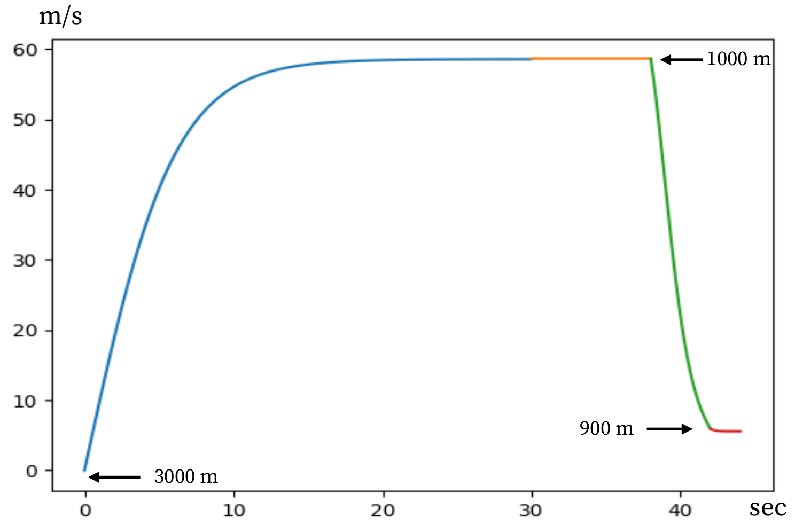
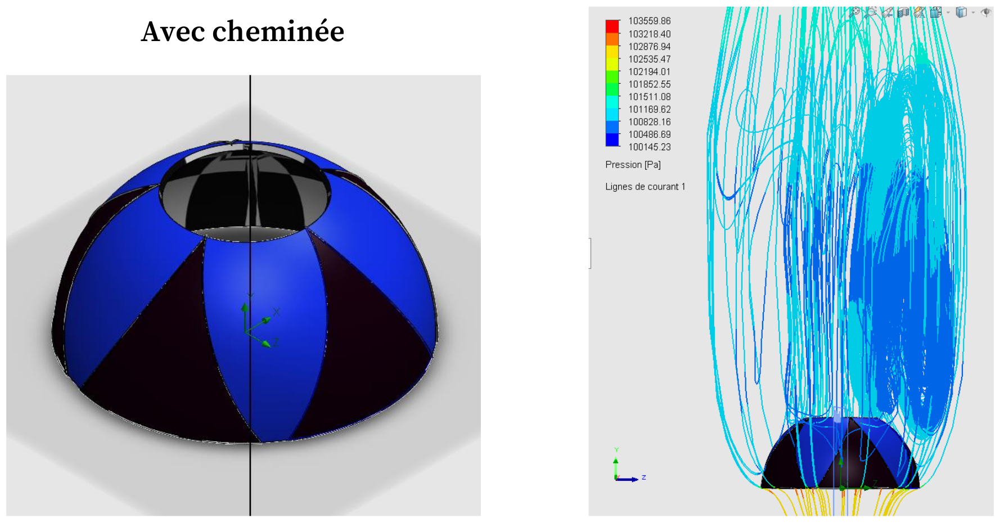
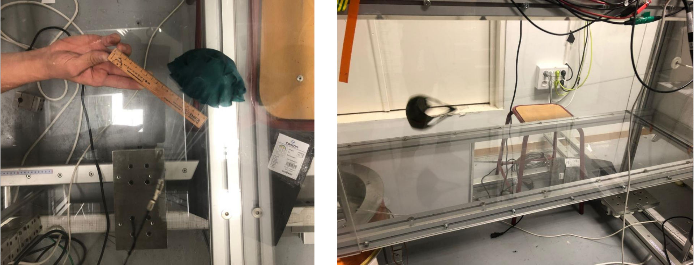

# Parachute Dynamics: Modelling, CFD and Wind-Tunnel Testing (TIPE)

**Context:** research project (TIPE) at the end of my 2-year CPGE (Mathematics & Physics preparatory program), 2021--2022, Lyon, France

**Tools:** Python (NumPy, Matplotlib, PIL), SolidWorks + Flow Simulation (CFD), wind tunnel at ENS Lyon

**Wind-tunnel supervision:** Prof. Mickael Bourgoin (ENS Lyon)

**Presentation:** [Slides](Presentation_Parachute_AJ.pdf)

---

## Research question

> How should the shape, size and fabric of a parachute canopy be adapted to the size and mass of the jumper?

The goal was to size a round (corolle-type) canopy for a 90 kg beginner jumping from 3000 m so that the landing speed is about 20 km/h, and to study how canopy size, load, fabric porosity and a central vent ("cheminee") affect drag and stability.

## 1. Analytical model

The jumper + parachute is modelled as a point mass subject to weight and quadratic aerodynamic drag:

```
dv/dt = g - (1 / 2m) * rho * S * C * v^2
```

with `rho` = 1.225 kg/m^3 (air density), `S` the projected area and `C` the drag coefficient. The equation can be solved analytically (Riccati-type, giving a `tanh` solution for the speed) and gives the terminal speed `v_lim = sqrt(2mg / (rho * S * C))`.

Applying the terminal-speed condition for a 20 km/h (5.56 m/s) landing with `C = 1.42` and `m = 90 kg` gives a required canopy area of **S = 32.8 m^2**.

## 2. Numerical simulation (Python, Euler method)

I solved the non-linear ODE numerically with an explicit Euler scheme in Python for the three phases of a jump:

| Phase | Parameters | Result |
|---|---|---|
| Free fall | m = 90 kg, S ~ 1 m^2, C = 0.42 | Terminal speed ~ **58.6 m/s (208 km/h)**, reached after ~20 s |
| Canopy opening | S(t) grows exponentially up to 32.8 m^2, C = 1.42 | Deceleration of about **1.4 g** |
| Descent under canopy | S = 32.8 m^2, C = 1.42 | Speed converges to **5.56 m/s (20 km/h)** |

The three phases were chained into a full 3000 m jump profile (free fall, opening around 1000 m, landing speed reached by about 900 m).



## 3. CFD simulation (SolidWorks Flow Simulation)

I modelled the canopy as a thin-shell hemisphere with gores in SolidWorks, in two variants: **with** and **without a central vent**. Using Flow Simulation (CFD), I computed the drag force on the canopy for air speeds from 6 to 18 m/s, with the convergence of the force goal checked in the solver (a few thousand fluid cells, converged in about 40 iterations).

The drag coefficient is then obtained from the simulated force:

```
C = 2F / (rho * S * v^2)
```

Result: `C` stays almost constant over the speed range, at about **1.435**, which is consistent with the value of 1.42 used in the analytical model.




## 4. Experiments

- **Drop tests:** the same parachute with three different ballast masses, and three parachutes of different sizes with the same ballast, tracked over time. As expected, a heavier load falls faster and a larger canopy falls more slowly.
- **Fabric porosity (image analysis in Python):** I photographed the fabric under a microscope, wrote a thresholding program to turn the image into black/white pixels, and computed the porous fraction as a function of the threshold. The fabric came out at about **28% porosity**, a characteristic that could also be used to check the state of a parachute.
- **Wind-tunnel drag measurements (ENS Lyon):** canopies were held in the airflow and the drag force was measured with a balance and pulley, while the air speed was deduced from the dynamic pressure. I compared porous and non-porous fabric, with and without a central vent, for speeds between about 6 and 16 m/s.



## 5. Conclusions

- A **32.8 m^2** round canopy lets a 90 kg jumper land at about 20 km/h.
- A **non-porous fabric** gives a higher drag coefficient.
- A **central vent** is recommended to keep the canopy stable in flight. In the wind tunnel, the vented canopies showed a drag coefficient that varied more with speed than the canopies without a vent.

## Limitations and what I would do next

- The wind-tunnel drag coefficients (about 0.7 to 1.0) are lower than the CFD value (about 1.4). Plausible causes are the rigid shell versus the flexible fabric canopy in the tunnel, the choice of reference area, and the scale of the models. I did not investigate this in depth at the time. <!-- Adjust this sentence to what you actually know about the cause. -->
- The model is one-dimensional (vertical motion only) and the canopy is rigid in the CFD study. Today I would add horizontal wind, canopy flexibility (fluid-structure interaction) and a mesh-convergence study.

## What this project taught me

First hands-on experience with the full engineering loop: physical modelling, numerical solution, CFD, experimental validation and critical comparison of the results. It is also where my interest in fluid dynamics started.